  <h1>👋 Привет! Меня зовут p1ka</h1>
  <h3>Энтузиаст серверной части</h3>

## 📖 Обо мне.

[EN] I'm a **Python, C++ | Java | JS | C#** developer from Russia.
[RU] Я пишу на  |  Python | CPP | Java | JavaScript | C# | Разработчик из RU.

Я разработчик плагинов для Майнкрафт, а так-же разработчик вспомогающих приложений для ПК.

---

## 📂 Мои проекты
Мафия на MC 26.3 PAPER - https://github.com/pikecodee/P1keMafiaGame
